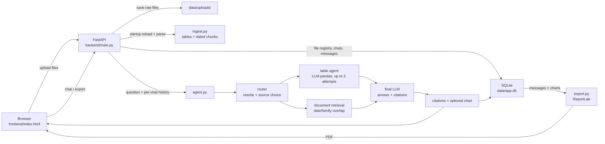

# VoltKart Multi-Source Chat Assistant

A full-stack chat assistant for asking questions about uploaded CSV tables and dated company documents. It combines exact pandas computations, document-version handling, citations on every answer, persistent chat memory, multiple chats, inline charts, and PDF chat export.

The backend is FastAPI, storage is SQLite, document/table parsing uses pandas, pypdf and python-docx, PDF export uses ReportLab, and the AI layer accepts any OpenAI-compatible endpoint. Ollama is the default. Built with AI assistance (Claude).

## Setup and run

### Prerequisites

- Python 3.10 or newer with `pip`
- An OpenAI-compatible LLM endpoint:
  - Local: install and start Ollama, then pull the default model shown below.
  - Hosted: use the Groq configuration in `.env.example` or another compatible provider.
- Internet access for the frontend CDN assets (`marked`, `DOMPurify`, `Chart.js`) and for any hosted LLM provider.

### From clone to working app

```bash
git clone <REPOSITORY_URL> voltkart
cd voltkart
python -m venv .venv
source .venv/bin/activate          # Windows PowerShell: .venv\Scripts\Activate.ps1
pip install -r requirements.txt
cp .env.example .env               # Windows PowerShell: copy .env.example .env
ollama pull qwen2.5:7b-instruct    # only for the default local Ollama setup
uvicorn backend.main:app --reload
```

For a hosted provider instead of Ollama, edit `.env` before starting the server: replace the `LLM_BASE_URL`, `LLM_API_KEY` and `LLM_MODEL` values with the chosen provider's settings. Do not commit `.env`; it is ignored by Git.

Open `http://localhost:8000`. Upload the six CSV tables from `sample_bundle/tables/`, the eight dated documents from `sample_bundle/documents/`, and `sample_bundle/DATA_DICTIONARY.md`, then ask a question in the chat box. More files can be uploaded later; uploading a file with the same name replaces the previous copy.

Uploaded files live in `data/uploads/`, and chats and messages live in `data/app.db`. Both are reloaded on backend startup and are ignored by Git. To start from an empty app, stop the server, delete `data/app.db`, and empty `data/uploads/`.

Optional checks:

```bash
python -m tests.smoke_test     # offline end-to-end path with a fake LLM
python tests/ground_truth.py   # prints independent answers for the sample tables
```

## Architecture



| Component | Responsibility |
|---|---|
| `frontend/index.html` | Single-page UI for chats, uploads, Markdown answers, expandable citations, inline charts and PDF export. |
| `backend/main.py` | HTTP endpoints, static frontend, startup reload, upload handling and per-chat message/export routes. |
| `backend/ingest.py` | Parses CSV into DataFrames, extracts dates from PDF/DOCX/TXT documents, chunks text and exposes table schema. |
| `backend/agent.py` | Routes each question, writes/runs pandas for table questions, retrieves dated document versions, and composes the cited answer. |
| `backend/db.py` | SQLite schema and helpers for chats, messages and the uploaded-file registry. |
| `backend/export.py` | Builds ordered chat PDFs with timestamps, citations and rendered charts. |
| `tests/` | Offline smoke test and independent table ground-truth calculations. |

Flow: an upload is saved under `data/uploads/`, registered in SQLite, and parsed into in-memory tables or date-tagged chunks. On a question, `/api/chats/{cid}/messages` loads only that chat's history. `route()` rewrites follow-up questions into standalone questions and selects tables, documents and an optional chart type. `table_agent()` gives the LLM the schema, samples and data dictionary, asks for pandas code, executes it in a restricted namespace, and retries failures with error feedback. `pick_docs()` selects the best-matching document families and supplies all their versions newest first. `answer()` asks the final LLM to cite every fact, then persists and returns the answer, citations and chart data. The export endpoint reads the same stored messages and rebuilds the PDF.

## Requirements coverage

| Requirement | How it is met |
|---|---|
| Core 1: chat interface | `frontend/index.html` sends messages and renders complete assistant responses as sanitized Markdown using `marked` and `DOMPurify`; Markdown tables and code are supported. A "Thinking…" placeholder is shown while the request is in flight. |
| Core 2: file upload | The sidebar uploads multiple files through `POST /api/files`. CSV, PDF, DOCX, TXT and MD are accepted, listed with metadata, and usable immediately. Re-uploading the same filename replaces it; registered files are reparsed after a backend restart. |
| Core 3: questions over related tables | CSVs are loaded as pandas DataFrames with ISO date columns already parsed. The table agent receives table names, dtypes, sample rows and the uploaded data dictionary, generates `.merge()` joins, and runs the code in a restricted namespace with up to three attempts. Answers use the computed result rather than estimates. |
| Core 4: questions over dated documents | `ingest.py` extracts a document date from the body label first and the filename second, then chunks PDF pages, DOCX headings/tables and TXT sections. `pick_docs()` groups chunks by document family, selects matching families and passes all versions newest first. Answer rules make the newest version win on conflicts and require an older date to be named when used. |
| Core 5: citations on every answer | The final LLM is instructed to tag facts with `[T#]` or `[D#]`. Table citations show the tables used, generated query and result; document citations show filename, document date, page/section and an excerpt. The UI renders expandable citation details. Missing tags fall back to all consulted sources, and the prompt requires an explicit "could not find" answer when sources are insufficient. |
| Core 6: conversation memory | Chats and messages are stored in SQLite. Each request loads only the current chat's history; the router uses the last six turns to resolve follow-ups and the final prompt uses the last eight. History survives backend restarts, and the first user message becomes the chat title. |
| Core 7: chat export | `GET /api/chats/{cid}/export.pdf` builds a PDF with every user and assistant message in order, timestamps, citations under each answer, and chart images where present. |
| Bonus 8: web search toggle | **Not attempted.** There is no search toggle, web tool, web citation or web-search state in exports. Answers are restricted to uploaded sources and chat history. |
| Bonus 9: multiple chats | **Attempted and implemented.** Chats can be created, listed and switched from the sidebar. Messages are keyed by `chat_id`, titles are generated from the first question, and each request reads only the selected chat's history. |
| Bonus 10: charts | **Attempted and implemented.** The router detects bar, line and pie requests; the table agent produces a two-column result; Chart.js renders the chart inline with a title and axis labels; ReportLab renders the same chart in the PDF; and table citation `T1` is attached even if the final LLM omits the tag. |

## Known limitations and improvements

| Current limitation | What I would improve with more time |
|---|---|
| Table answers depend on the LLM writing correct pandas. Complex joins and filters can fail on smaller local models; up to three attempts reduce but do not remove this. The `exec` namespace is restricted, but it is not a security sandbox. | Add a deterministic query layer or SQL/whitelisted operations for common aggregations, validate generated code more strictly, run it in an isolated worker, and build a larger regression suite of join and filter questions. |
| Citation placement relies on the final model following the tagging rule. A missing tag falls back to all consulted sources rather than verifying each fact, and document excerpts are capped at 400 characters. | Add post-generation validation that checks every factual sentence against a source span, preserve complete relevant excerpts, and reject or retry answers with unmatched claims. |
| Document retrieval is IDF-weighted word overlap over at most two matching families with 2,000-character chunks. Semantic paraphrases and long documents can be missed. | Use hybrid BM25/embedding retrieval with a reranker, adaptive chunking, query expansion and confidence thresholds. |
| Newest-version handling is enforced by prompt instructions rather than a deterministic fact/date rule engine. | Extract structured facts with their effective dates and apply explicit conflict rules before answer generation. |
| Memory is limited to the last six router turns and last eight final-prompt turns; older details in long chats can be lost. | Add conversation summarization and history retrieval with a token budget so older relevant context remains available. |
| Uploaded files are global across chats, same-name uploads overwrite each other, and there is no delete/rename workflow or authentication. | Scope files to workspaces or chats, use stable file IDs instead of names, add file management controls, and add user authentication for multi-user deployment. |
| Responses are complete rather than streamed, frontend libraries are loaded from a CDN, dependencies are unpinned, and startup uses FastAPI's older `on_event` hook. | Add streaming responses, vendor frontend assets, commit a lockfile with pinned versions, and migrate to FastAPI's lifespan handler. |
| Testing is limited to one offline smoke path and manually inspected ground-truth output. | Add automated end-to-end tests for all core questions, document-version conflicts, citations, restart persistence, export content and chart values, then run them in CI. |
| Web search is not implemented. | Add a per-message toggle backed by a search API, return title/URL citations for web facts, and include the toggle state in PDF exports. |
